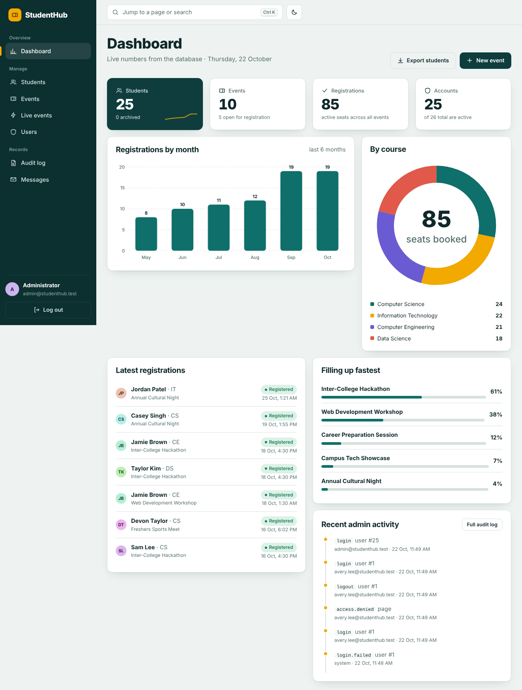

<<<<<<< HEAD
# StudentHub

One PHP + MySQL project that delivers **Practicals 7–15**: campus events as tickets, student records, secure accounts, a JSON API with live (AJAX) editing, and an admin dashboard with charts and an audit trail.



## Quick start (XAMPP)

1. Extract to `C:\xampp\htdocs\studenthub` (so `index.php` is directly inside).
2. Start **Apache** and **MySQL** in XAMPP.
3. phpMyAdmin → **Import** → `database/studenthub.sql`.
4. Open `http://localhost/studenthub/test_connection.php` (all rows should pass), then `http://localhost/studenthub/`.

| Role | Email | Password |
| --- | --- | --- |
| Admin | `admin@studenthub.test` | `Admin123!` |
| Student | `avery.lee@studenthub.test` | `Student123!` |

All 24 seeded students use `Student123!`. These are demo accounts for local use; change them before any public deployment. More options (virtual host, online deployment): `docs/DEPLOYMENT.md`.

## What is inside

| Area | Pages |
| --- | --- |
| Public | `index.php` home · `events.php` browser · `contact.php` (P7) · `register.php` (P9) · `login.php` (P10) · `test_connection.php` (P8) |
| Student | `dashboard.php` tickets · `profile.php` · register / cancel seats without reload |
| Admin | `admin.php` dashboard (P14) · `students.php` (P11) · `manage-events.php` (P12) · `events-live.php` AJAX CRUD (P13) · `users.php` · `audit.php` · `messages.php` (P7 viewer) |
| API | `api/events.php`, `api/students.php`, `api/register.php`, `api/search.php`, `api/session.php` |

The practical-by-practical map, extensions delivered and viva answers are in **`docs/PRACTICALS.md`**.

## Advanced UI features

- **Event tickets** with a perforated stub showing live seats left and a fill bar.
- Light / dark theme (remembers your choice, respects the OS setting), responsive down to phones with a slide-in menu.
- **Command palette** (`Ctrl/⌘ + K`): jump to any page or search students and events as you type.
- Toast notifications, native accessible dialogs for add / edit / confirm, skeleton loaders, animated counters and SVG charts (bar, donut, sparkline) with no external libraries.
- Live validation that uses the same rules as the server, password strength meter, show / hide password.
- Drag-and-drop poster upload with preview and instant type / size checks.
- Sortable tables, debounced search, filter chips, pagination, CSV export.
- Session countdown in the top bar with a “Stay signed in” prompt before automatic sign-out.
- **API inspector** on the live-events page showing the last request, status code, timing and raw JSON.
- Keyboard friendly, `prefers-reduced-motion` aware, skip link and ARIA labels.

## Security highlights

Prepared statements everywhere · `password_hash` / `password_verify` · CSRF on forms and API · session ID regeneration, HttpOnly + SameSite cookies, inactivity timeout · login lock-out · hashed remember-me tokens · role-based access with audit of denials · validated, renamed, non-executable uploads · CSP without inline scripts · CSV-injection protection. Full table: `docs/SECURITY-ACCESSIBILITY-CHECKLIST.md`.

## Tests

```bash
php -S 127.0.0.1:8099 -t .
python3 tests/e2e_test.py          # 189 checks, resets the DB, writes docs/test-results.md
```

Results and the screenshot index are in `docs/TEST-REPORT.md`.

## Project layout

```
index.php  events.php  contact.php  register.php  login.php  logout.php
dashboard.php  profile.php  admin.php  students.php  manage-events.php
events-live.php  users.php  audit.php  messages.php  test_connection.php
api/            JSON endpoints            includes/   config, db, bootstrap, ui, libraries
assets/         css + js (no frameworks)  database/   studenthub.sql (schema, seed, procedures)
storage/        CSV + JSON submissions    uploads/    poster images (script execution disabled)
docs/           report, ER, checklist, screenshots   deploy/   Apache vhost   static-demo/  online showcase
tests/          e2e_test.py
```

## Submit to GitHub

```bash
git init && git add . && git commit -m "StudentHub: practicals 7-15 final integration"
git branch -M main && git remote add origin https://github.com/<you>/studenthub.git && git push -u origin main
```

`.gitignore` already excludes runtime uploads and submitted messages.

## Troubleshooting

| Symptom | Fix |
| --- | --- |
| “The database is not reachable” | Start MySQL, import `database/studenthub.sql`, check `includes/config.php` |
| Blank page / 500 | Enable `STUDENTHUB_DEBUG=1` temporarily or read `xampp/php/logs/php_error_log` |
| Links go to the wrong folder | Set `STUDENTHUB_BASE_URL` (e.g. `/studenthub`) if you use unusual aliases |
| Poster upload fails | JPEG / PNG / WebP under 2 MB; make `uploads/posters` writable |
| Fonts look different offline | Fonts load from Google Fonts; a system font is used when offline |
=======
# GEN Z — Student Portal Hub

A responsive, multi-page student portal built with **HTML, CSS, and Bootstrap 5**.
Includes login/signup, a dashboard, and Marks / Attendance / Results / Profile pages.

## File structure

```
student-portal/
├── index.html        Landing page (Login/Sign Up in top-right nav)
├── login.html         Log in form
├── signup.html         Sign up form
├── dashboard.html      Protected — overview, KPIs, marks snapshot, notices
├── marks.html           Protected — full subject-wise marks ledger
├── attendance.html    Protected — attendance donut + per-subject progress
├── results.html          Protected — semester-wise SGPA + CGPA
├── profile.html          Protected — edit details, change password
├── admin/
│   ├── index.html          Admin dashboard — portal-wide stats
│   ├── students.html        Manage students — search, add, edit, delete
│   └── attendance.html      Attendance manager — edit any student's records
├── css/style.css        All custom styling (design tokens, layout, components)
└── js/
    ├── auth.js               Signup / login / session / logout + admin helpers
    ├── sidebar.js             Mobile sidebar toggle (shared)
    ├── dashboard.js           Populates dashboard.html
    ├── marks.js               Populates marks.html
    ├── attendance.js          Populates attendance.html
    ├── results.js             Populates results.html
    ├── profile.js             Populates + edits profile.html
    ├── admin-dashboard.js     Populates admin/index.html
    ├── admin-students.js      Powers admin/students.html
    └── admin-attendance.js    Powers admin/attendance.html
```

## Admin panel

Log in with the seeded demo admin account and you're routed straight to the
admin panel instead of the student dashboard:

```
Email:    admin@GEN Z.example
Password: admin123
```

From there:
- **Admin Dashboard** — total students, average attendance/marks across the
  whole portal, and a live list of anyone below the 75% attendance mark.
- **Manage Students** — search/filter every account, add a new student
  (auto-generates their Student ID and seeds their academic data), edit
  their profile or reset their password, or remove an account entirely.
- **Attendance Manager** — pick any student, edit their held/attended count
  per subject directly, or use "Mark present today" to bump both numbers by
  one in a click. A sidebar panel flags every student currently below 75%.

Student accounts never see the admin panel — `requireAuth()` on the student
pages detects the `admin` role and redirects to `admin/index.html`, and
`requireAdmin()` on the admin pages redirects anyone who isn't an admin back
to the student dashboard.

Every protected page starts with `requireAuth()`, which checks for a session and
redirects to `login.html` if none exists — so someone can't reach the dashboard
pages just by typing the URL without logging in first.

## How the demo data works

When someone signs up, `seedStudentData()` in `auth.js` generates a set of
random subjects/marks/attendance/results and stores it under
`GEN Z_data_<studentId>` in `localStorage`, so every account has its own
independent set of numbers to explore.

## ⚠️ About "secure" credential storage — please read

You asked for credentials to be stored securely. I want to be upfront about a
limitation: **a static HTML/CSS/JS site has no server, so there is no way to
truly secure passwords client-side.** Here's exactly what this project does,
and doesn't do:

- Accounts and passwords live in the browser's `localStorage` (`GEN Z_students_v1`).
- Passwords are run through a `btoa()` obfuscation function before storing —
  this stops them being plain, readable text at a glance, but **it is not
  encryption or hashing**. Anyone with DevTools access to that browser can
  decode it in seconds.
- There's no server validating requests, no HTTPS transport to protect, and
  no way to stop someone from editing `localStorage` directly.

This is genuinely fine for what it sounds like you need it for — a class
project, portfolio piece, or prototype. **If you ever plan to use this with
real student data or deploy it publicly**, the credential/auth logic needs to
move to a real backend. Since your memory shows you already work with Django:
a natural next step would be a Django backend using `django.contrib.auth`
(which handles password hashing with PBKDF2/Argon2 out of the box), session
or token auth, and a database — with this HTML/CSS/Bootstrap front end either
kept as-is (calling a Django REST API) or converted to Django templates.

## Customizing

- Colors, fonts, spacing: all defined as CSS variables at the top of `css/style.css`.
- Subjects/marks/attendance ranges: edit `seedStudentData()` in `js/auth.js`.
- Add a new protected page: copy the sidebar markup from any dashboard-style
  page, link `js/auth.js` + `js/sidebar.js`, and call `requireAuth()` at the
  top of your page's script.
>>>>>>> 23a38893061f55475999e5285128c98f21a2be4e
